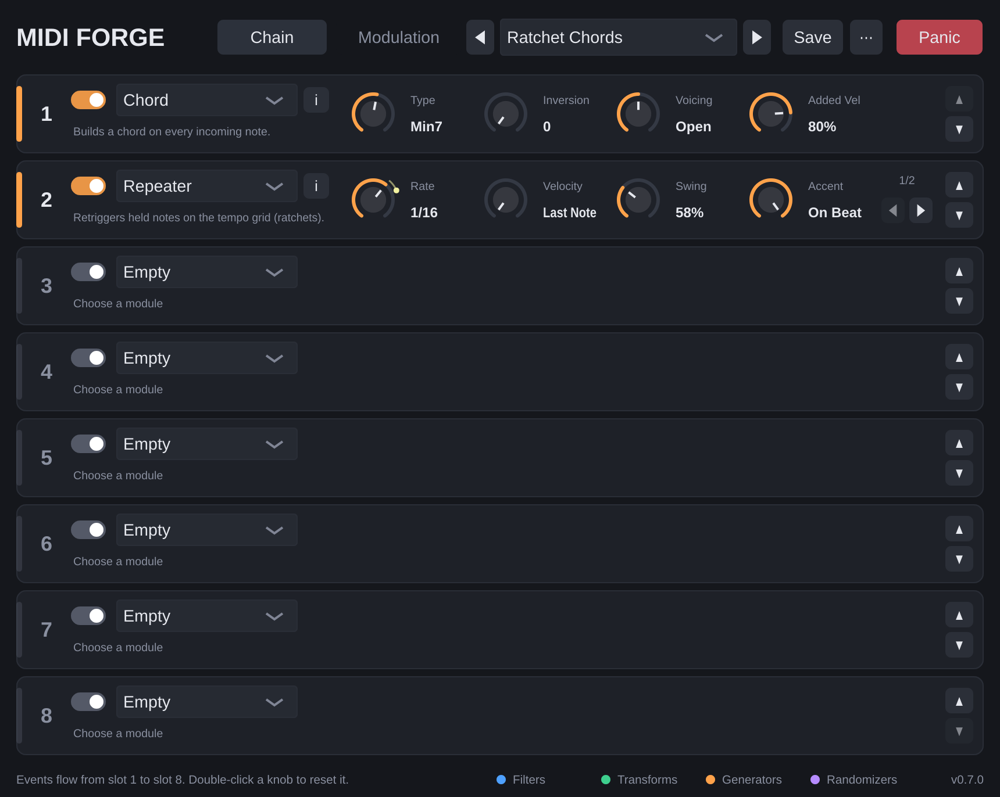

# MIDI Forge

A modular MIDI filter and effect plug-in. Stack up to eight modules – filters, transforms, generators
and randomizers – in front of any instrument.

- **Formats:** VST3 and CLAP · **Systems:** Windows, macOS (Apple Silicon + Intel)
- **Made for:** Reaper and Bitwig Studio (any host that supports MIDI-effect plug-ins should work)
- **16 modules:** Note Range, Velocity Range, Channel Filter, Event Blocker, Note Split, Transpose, Scale Quantize,
  Velocity Curve, Channel Remap, Arpeggiator, Chord, Note Echo, Repeater (ratchets), Humanize,
  Probability, Random Pitch
- **4 LFOs, 4 Random modulators and 8 modulation routes** move any module setting: LFOs tempo-synced or
  free with 7 waveforms; Random modulators pick a new value per played note or chord; bipolar or unipolar per route
- **Your own presets**, saved as files you can back up and share, plus 11 factory presets
- **Module browser with search** and built-in help for every module and knob
- No stuck notes, even when you change modules while playing

## Download

- **Releases:** the *Releases* section of this repository.
- **Latest build:** *Actions* tab → latest green *Build* run → *Artifacts* → `MIDI-Forge-Windows` or `MIDI-Forge-macOS`.

Installation and usage: **[User manual](docs/MANUAL.md)**.

## Development

The plug-in is built entirely by GitHub Actions – nothing needs to be built locally.

- [CONTRIBUTING.md](CONTRIBUTING.md) – ground rules, building, checks, releases
- [docs/ARCHITECTURE.md](docs/ARCHITECTURE.md) – how the code is organised
- [docs/IDEAS.md](docs/IDEAS.md) – planned features and ideas
- [SECURITY.md](SECURITY.md) – reporting vulnerabilities

Built with [JUCE](https://juce.com) and [clap-juce-extensions](https://github.com/free-audio/clap-juce-extensions).
