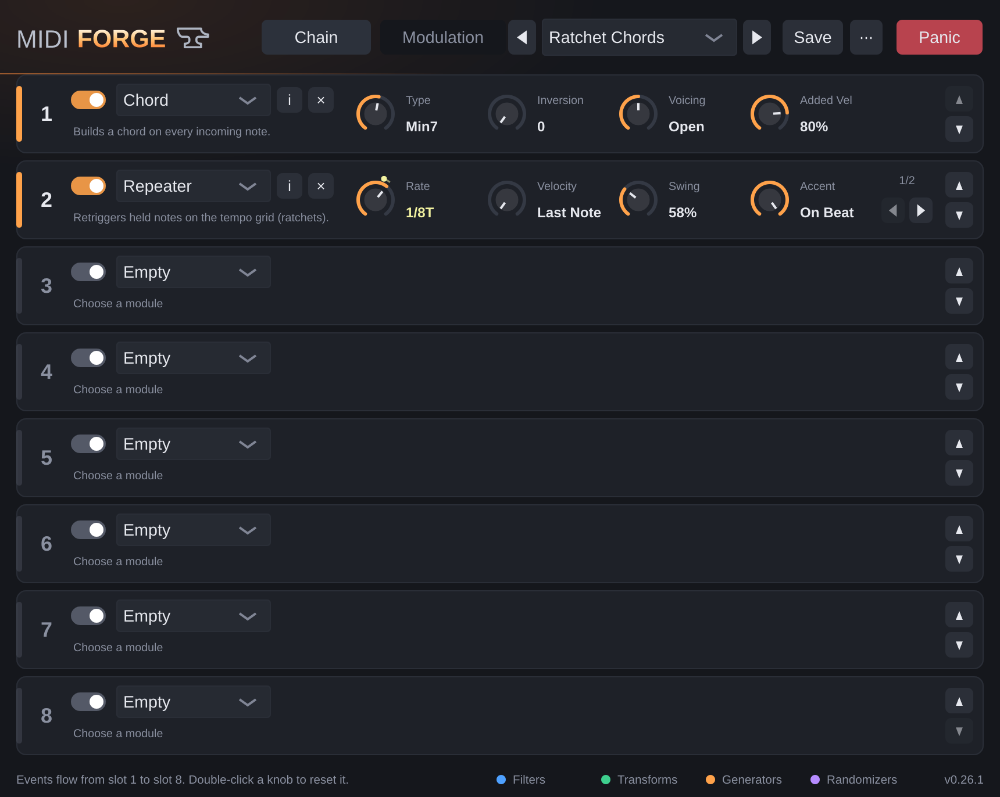

# MIDI Forge

A modular MIDI filter and effect plug-in. Stack up to eight modules – filters, transforms, generators
and randomizers – in front of any instrument.

- **Formats:** VST3 and CLAP (Windows, macOS), Audio Unit (macOS) · **macOS:** universal (Apple Silicon and Intel),
  checked automatically but not yet tried on a Mac
- **Made for:** Reaper and Bitwig Studio (any host that supports MIDI-effect plug-ins should work)
- **25 modules:** Note Range, Velocity Range, Channel Filter, Event Blocker, Note Split, Transpose, Scale Quantize,
  Velocity Curve, Channel Remap, Note Dispatcher, Groove, Arpeggiator, Chord, Diatonic Harmonizer, Note Echo,
  Repeater (ratchets), Strum, Ghost Notes, Bounce, Humanize, Probability, Beat Thinning, Random Pitch, Pitch Slide,
  Mutate
- **Follows the DAW's time signature** (4/4, 3/4, 6/8, 7/8 …) wherever bars matter
- **4 LFOs, 4 Random modulators, 4 step modulators and 12 modulation routes** move any module setting, switch
  slots on and off, or move the modulation itself (route amounts, LFO rate/phase/width, step rate/glide): LFOs tempo-synced or free with 7 waveforms; Random modulators pick a new value per played
  note or chord; step modulators play 4–16 drawn steps in time with the song; bipolar or unipolar per route
- **Your own presets**, saved as files you can back up and share, plus 12 factory presets
- **Module browser with search** and built-in help for every module and knob
- No stuck notes, even when you change modules while playing

## Download

- **Releases:** the *Releases* section of this repository.
- **Latest build:** *Actions* tab → latest green *Build* run → *Artifacts* → `MIDI-Forge-Windows` or
  `MIDI-Forge-macOS`.

Installation and usage: **[User manual](docs/MANUAL.md)**.

## Development

The plug-in is built entirely by GitHub Actions – nothing needs to be built locally.

- [CONTRIBUTING.md](CONTRIBUTING.md) – ground rules, building, checks, releases
- [docs/ARCHITECTURE.md](docs/ARCHITECTURE.md) – how the code is organised
- [CHANGELOG.md](CHANGELOG.md) – what changed in each release
- [docs/IDEAS.md](docs/IDEAS.md) – planned features and ideas
- [SECURITY.md](SECURITY.md) – reporting vulnerabilities

Built with [JUCE](https://juce.com).

## Licence

Copyright (C) 2026 Udo Gerhards. MIDI Forge is free software: you can redistribute it and/or modify it under the terms of the
[GNU Affero General Public License, version 3](LICENSE). It comes with no warranty. JUCE is used under
its AGPLv3 licence; the licences of the other third-party code in the plug-ins (VST3 SDK, CLAP and
clap-juce-extensions, Apple's Audio Unit SDK) come with every download in `THIRD-PARTY-NOTICES.txt`.
