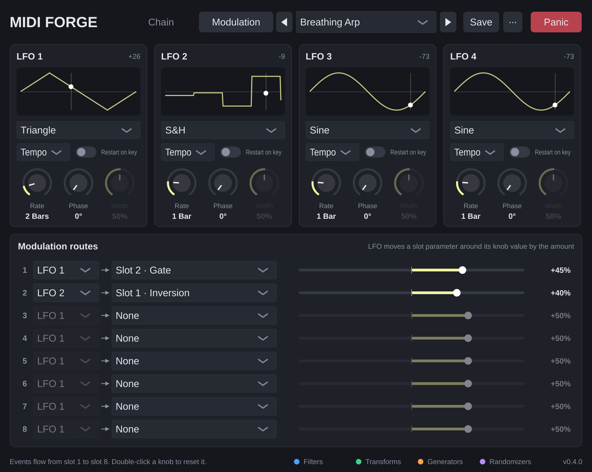

# MIDI Forge – User Manual

MIDI Forge is a MIDI effect plug-in (VST3 and CLAP) for Windows and macOS. It sits in front of an
instrument and changes the MIDI on its way there: it can filter notes out, transform them, generate
new ones and add controlled randomness. You build the effect from up to eight **modules** that you
stack in **slots**.

- [Installation](#installation)
- [Where to put it in your DAW](#where-to-put-it-in-your-daw)
- [The window](#the-window)
- [How the chain works](#how-the-chain-works)
- [Modules](#modules)
- [Modulation (LFOs)](#modulation-lfos)
- [Presets](#presets)
- [Automation](#automation)
- [Panic and stuck notes](#panic-and-stuck-notes)
- [Troubleshooting](#troubleshooting)

---

## Installation

Download the zip for your system from the project's **Releases** page on GitHub (or, for test builds,
from the **Actions** tab → latest successful run → *Artifacts*). Each zip contains both formats; install
whichever your DAW prefers. Bitwig works best with CLAP; Reaper loads both.

| System  | VST3 folder                                   | CLAP folder                                   |
|---------|-----------------------------------------------|-----------------------------------------------|
| Windows | `C:\Program Files\Common Files\VST3\`         | `C:\Program Files\Common Files\CLAP\`         |
| macOS   | `~/Library/Audio/Plug-Ins/VST3/`              | `~/Library/Audio/Plug-Ins/CLAP/`              |

**macOS only:** the plug-in is not notarized by Apple, so macOS blocks it after downloading. Run this
once in Terminal after copying the files:

```sh
xattr -dr com.apple.quarantine ~/Library/Audio/Plug-Ins/VST3/"MIDI Forge.vst3"
xattr -dr com.apple.quarantine ~/Library/Audio/Plug-Ins/CLAP/"MIDI Forge.clap"
```

Then let your DAW rescan its plug-ins.

## Where to put it in your DAW

- **Reaper:** add MIDI Forge to a track's FX chain *above* the instrument. MIDI flows top to bottom.
- **Bitwig Studio:** put MIDI Forge in an instrument's **Note FX** section, or as a device before the instrument.

MIDI Forge does not process audio. Ableton Live cannot host MIDI-effect plug-ins.

## The window


- **Header:** the **Chain** and **Modulation** tabs, the [preset controls](#presets) and the **Panic** button.
- The **Chain** tab shows the **eight slot rows**, each with:
  - the **slot number** and a coloured strip showing the module's category,
  - a **power switch** – a switched-off slot passes everything through unchanged,
  - the **module menu** – pick what this slot does; picking a module resets its knobs to their defaults,
  - a one-line **description** of the module,
  - up to **four knobs** – drag up/down or left/right; **double-click** to reset a knob,
  - **▲ / ▼** buttons that move the module one slot up or down.
  - A knob that an LFO is moving gets a thin **yellow ring with a dot**: the knob shows your setting,
    the dot shows the value the module is using right now.
- The **Modulation** tab holds the LFOs and modulation routes, see [Modulation (LFOs)](#modulation-lfos).
- **Footer:** the colour legend: blue = filters, green = transforms, orange = generators, purple = randomizers.

Note names follow the convention **C3 = MIDI note 60** (as in Bitwig and Cubase; Reaper calls it C4 by default).

## How the chain works

Every MIDI event enters slot 1, then goes to slot 2, and so on to slot 8. Each module only sees what
the slots above it let through, so **order matters**: *Chord → Arpeggiator* arpeggiates chords, while
*Arpeggiator → Chord* plays a chord on every arpeggio step.

MIDI Forge takes care that no note gets stuck, even when you change modules while playing:

- Notes always end the way they started, even if you turn a knob while holding them (a transposed note
  is released at the pitch it started on).
- Switching a slot's module, turning a slot on or off, or moving modules releases the notes passing
  through that slot. Keep holding the key and nothing restarts until you press it again.
- SysEx messages pass through untouched; MIDI clock and other system messages pass through every module.

## Modules

The four knobs of a slot are called **A, B, C, D** in your DAW's automation lists; what they mean depends
on the module loaded in the slot.

### Filters (blue)

**Note Range** – passes or blocks notes inside a key range.

| Knob | Range | Meaning |
|------|-------|---------|
| Low  | C-2 … G8 | Lowest key of the range |
| High | C-2 … G8 | Highest key of the range (Low and High may be swapped) |
| Mode | Pass inside / Block inside | Keep only notes in the range, or remove them |

**Velocity Range** – passes or blocks notes by how hard they were played.

| Knob | Range | Meaning |
|------|-------|---------|
| Min  | 1 … 127 | Lowest velocity of the range |
| Max  | 1 … 127 | Highest velocity of the range |
| Mode | Pass inside / Block inside | Keep or remove notes in the range |

**Channel Filter** – keeps or removes one MIDI channel. Applies to every channel message (notes, CC, pitch bend …).

| Knob | Range | Meaning |
|------|-------|---------|
| Channel | 1 … 16 | The channel |
| Mode | Only this / All except | Keep only this channel, or remove it |

**Event Blocker** – blocks whole kinds of MIDI events.

| Knob | Range | Meaning |
|------|-------|---------|
| Notes | Pass / Block | Notes (and their poly aftertouch) |
| CC | Pass / Block | Control changes (mod wheel, sustain pedal …) |
| Pitch Bend | Pass / Block | Pitch bend |
| AT / Prog | Pass / Block | Channel aftertouch, poly aftertouch and program changes |

### Transforms (green)

**Transpose** – shifts notes. Notes pushed outside the MIDI range are dropped.

| Knob | Range | Meaning |
|------|-------|---------|
| Semitones | −24 … +24 st | Shift in semitones |
| Octave | −4 … +4 oct | Additional shift in octaves |

**Scale Quantize** – moves every note into a key and scale.

| Knob | Range | Meaning |
|------|-------|---------|
| Root | C … B | Key of the scale |
| Scale | Major, Minor, Dorian, Phrygian, Lydian, Mixolydian, Locrian, Harm. Minor, Mel. Minor, Major Pent., Minor Pent., Blues, Whole Tone | The scale |
| Snap | Nearest / Up / Down | Where wrong notes go. *Nearest* picks the lower note when both are equally close |

If two keys land on the same scale note, it keeps sounding until both keys are released.

**Velocity Curve** – reshapes how hard notes are played.

| Knob | Range | Meaning |
|------|-------|---------|
| Curve | −100 … +100 | Negative: soft playing gets louder (more sensitive). Positive: you have to play harder. 0: linear |
| Out Min | 1 … 127 | Velocity of the softest possible note |
| Out Max | 1 … 127 | Velocity of the hardest possible note |
| Fixed | Off, 1 … 127 | If not Off, every note gets exactly this velocity (Curve, Out Min and Out Max are ignored) |

**Channel Remap** – moves events to another channel. Applies to all channel messages.

| Knob | Range | Meaning |
|------|-------|---------|
| From | All, 1 … 16 | Which channel to move (All = every channel) |
| To | 1 … 16 | Target channel |

### Generators (orange)

**Arpeggiator** – plays the keys you hold one after another. While your DAW's transport runs, the steps
lock to the bar grid; when it is stopped, the arpeggiator runs on its own clock (at the project tempo)
and starts the moment you press the first key. The keys you hold are not passed on – only the arpeggio.

| Knob | Range | Meaning |
|------|-------|---------|
| Rate | 1/4, 1/8, 1/8T, 1/16, 1/16T, 1/32 | Step length (T = triplet) |
| Pattern | Up, Down, Up/Down, Random, As Played | Order of the notes. *Up/Down* doesn't repeat the top and bottom note; *As Played* follows the order you pressed the keys |
| Octaves | 1 … 4 | How many octaves the pattern spans |
| Gate | 5 … 100 % | Note length as a share of the step |

Up to 32 keys are tracked at once.

**Chord** – plays a chord on every note.

| Knob | Range | Meaning |
|------|-------|---------|
| Type | Major, Minor, Sus2, Sus4, Dim, Aug, Maj7, Min7, Dom7, Min9, Add9, Power, Octave, 5th + Oct | The chord, built upwards from the played note |
| Inversion | 0 … 3 | Each step moves the lowest chord note up an octave |
| Voicing | Close / Open / Bass −1 Oct | *Open* raises the second-lowest note an octave; *Bass −1 Oct* adds the played note an octave lower |
| Added Vel | 0 … 100 % | Velocity of the added notes relative to the played note |

**Note Echo** – a MIDI delay. The original note plays immediately; each echo comes one *Time* later,
quieter, and optionally transposed. Every echo is as long as the original note.

| Knob | Range | Meaning |
|------|-------|---------|
| Time | 1/32 … 1 Bar (incl. triplets T and dotted D) | Distance between echoes, synced to the tempo |
| Repeats | 1 … 16 | Maximum number of echoes |
| Feedback | 10 … 100 % | Each echo's velocity as a share of the previous one. Echoes stop when they get too quiet |
| Pitch | −12 … +12 st | Transposition added with every echo (e.g. +7 makes a rising cascade of fifths) |

**Repeater** – ratchets: while you hold keys, every held note is played again and again on the tempo grid.
A held chord repeats as a chord. The key you press sounds **immediately**; the repeats then follow on the
grid. While your DAW plays, the grid is locked to its bars; when it is stopped, the Repeater runs at the
project tempo, counting from your first key press. Releasing a key stops its repeats. Each repeat lasts
half a step. If you press a key just before a grid step, that step is skipped for this key, so it never
double-triggers.

| Knob | Range | Meaning |
|------|-------|---------|
| Rate | 1/4D, 1/4, 1/8D, 1/4T, 1/8, 1/16D, 1/8T, 1/16, 1/16T, 1/32, 1/32T, 1/64 | Distance between repeats (D = dotted, T = triplet); turning right makes it faster |
| Velocity | Last Note / Aftertouch | *Last Note:* all repeats use the velocity of the key you pressed last. *Aftertouch:* how hard you press sets the velocity, live – per note if your keyboard sends polyphonic aftertouch, otherwise channel aftertouch; until you press, each note uses its own velocity. Aftertouch also still reaches your synth |
| Swing | 50 … 75 % | Delays every second repeat. 50 % is straight, 66 % is a triplet feel, 75 % a heavy shuffle |
| Accent | Off, Every 2nd, Every 3rd, Every 4th, On the Beat | Makes these repeats 25 velocity steps louder. Steps are counted on the grid (from your first key press when the transport is stopped). *On the Beat* accents repeats that fall on a quarter note |

Tip: an LFO on *Rate* makes the ratchet speed change on its own (see the *Ratchet Chords* preset).

### Randomizers (purple)

**Humanize** – makes playing less mechanical. Each note is delayed by a random amount and its velocity
varied. The note-off is delayed by the same amount, so note lengths stay as played.

| Knob | Range | Meaning |
|------|-------|---------|
| Timing | 0 … 50 ms | Maximum delay (notes are only ever delayed, never moved earlier) |
| Velocity | 0 … 64 | Maximum velocity change up or down |

**Probability** – each note plays with the given chance; the rest are skipped.

| Knob | Range | Meaning |
|------|-------|---------|
| Chance | 0 … 100 % | Probability that a note plays |

**Random Pitch** – randomly transposes some notes. Put a *Scale Quantize* after it to stay in key.

| Knob | Range | Meaning |
|------|-------|---------|
| Range | 0 … 24 st | Largest possible shift |
| Chance | 0 … 100 % | Share of notes that get shifted |
| Mode | Any / Octaves / 5ths + Oct | Which intervals are used |

## Modulation (LFOs)



The four **LFOs** (low-frequency oscillators) move slot knobs automatically, without DAW automation:
an LFO on *Note Echo · Pitch* makes the echoes rise and fall, an S&H on *Chord · Type* switches chords,
an LFO on *Arpeggiator · Gate* lets the notes breathe. The LFOs make no sound themselves; they only move
the settings of the MIDI modules. All of this lives on the **Modulation** tab.

### LFOs

| Control | Range | Meaning |
|---------|-------|---------|
| Wave | Sine, Triangle, Saw Up, Saw Down, Square, S&H, Smooth Random | The shape. *S&H* (sample and hold) jumps to a new random value every cycle; *Smooth Random* glides from one random value to the next |
| Sync | Tempo / Free | *Tempo:* the cycle length is a note value. *Free:* the speed is set in Hz |
| Rate (Tempo) | 8 Bars … 1/32 (incl. dotted D and triplets T) | Length of one cycle; turning right makes it faster |
| Rate (Free) | 0.01 … 20 Hz | Cycles per second |
| Phase | 0 … 360° | Shifts the wave, e.g. to run two LFOs against each other |
| Width | 5 … 95 % | Square wave only: how much of the cycle the wave is high |
| Restart on key | on / off | Restarts the cycle when you press a key while no other key is held, so every phrase starts the same way |

The preview shows the wave's shape and a white dot where the LFO is now; the number in the top right is
its current output (−100 … +100). For the random waves the preview shows an example of their character.

**Timing:** a tempo-synced LFO follows the DAW's bar grid while the transport runs, so it is always at the
same place at the same bar, even when you jump around in the song. When the transport is stopped it keeps
running at the project tempo. A free LFO always runs on its own clock.

### Modulation routes

The eight routes connect an LFO to a slot knob:

| Control | Meaning |
|---------|---------|
| Source | Which LFO (1 … 4) |
| Target | Which knob, named after the module in that slot, e.g. *Slot 2 · Gate*. *None* switches the route off |
| Amount | −100 … +100 %. How far the LFO moves the knob around its own setting. At 100 % the LFO can sweep the knob's whole range; negative amounts turn the LFO upside down. Double-click: 50 % |

- The LFO moves the parameter **around the knob's position**: set the knob to the centre of the movement you want.
  Values are limited to the parameter's range.
- Several routes on the same knob add up. One LFO can drive several routes.
- On knobs with fixed choices (scale, chord type, arpeggiator pattern …) the LFO steps through the choices.
- The module type and the slot's on/off switch cannot be modulated (switching them releases notes).
- If you change the module in a slot, routes to that slot keep pointing at the same knob position (A … D),
  which now belongs to the new module. The target name shows what it controls.
- Modulation never changes your knob settings, and it never writes into your DAW's automation.
- LFO values are taken at the exact moment a note arrives; notes the plug-in generates itself
  (arpeggio steps, echoes) use a value at most 32 samples old.

## Presets

A preset stores the complete setup: all eight slots, the four LFOs and the eight routes.

### The preset controls

| Control | What it does |
|---------|--------------|
| **◀ / ▶** | Previous / next preset: the factory presets first, then yours, wrapping around |
| **Preset menu** | Pick any preset. The menu has two sections, *Factory* and *User* (your presets, alphabetical) |
| **\*** after the name | Your settings differ from the saved preset |
| **Save** | If one of *your* presets is loaded: saves the changes into it. Otherwise asks for a name, like *Save As* |
| **⋯ → Save As…** | Saves the current settings under a new name (asks before replacing an existing preset) |
| **⋯ → Rename…** | Renames the loaded user preset |
| **⋯ → Delete** | Moves the loaded user preset to the trash (asks first). Your current settings stay as they are |
| **⋯ → Import…** | Copies a `.mfpreset` file (e.g. one someone sent you) into your presets and loads it. Never overwrites: a second copy gets " (2)" |
| **⋯ → Show preset folder** | Opens the folder in Explorer / Finder |

Factory presets cannot be changed or deleted; save your changes as your own preset instead.

### Where your presets are stored

Every preset is a small file called `Name.mfpreset` in

- **Windows:** `Documents\MIDI Forge\Presets\`
- **macOS:** `~/Documents/MIDI Forge/Presets/`

Because they are in one place, your presets are available in every project and every DAW. Back up or
share them by copying the files. You can also copy files into the folder directly; while the plug-in window
is open, MIDI Forge notices new or removed files within a couple of seconds. Names may not contain `/ \ : * ? " < > |` – such characters are
replaced by spaces.

Preset files are checked when they are loaded: files that are damaged, not from MIDI Forge, or larger
than 256 KB are refused, and values outside a parameter's range are limited to the range.

### Factory presets

| Preset | Chain |
|--------|-------|
| Init | All slots empty |
| Chord Arp | Chord (Min7) → Arpeggiator (1/16, Up/Down, 2 octaves) → Humanize |
| Scale Lock (C Minor) | Scale Quantize (C minor) → Velocity Curve (more sensitive, 20–120) |
| Echo Cascade | Note Echo (1/8 dotted, 6 repeats, +7 st) → Scale Quantize (C minor pentatonic) |
| Generative Dorian | Probability 60 % → Random Pitch (octaves) → Scale Quantize (D Dorian) → Note Echo (1/4 triplet) → Humanize |
| Bass Split to Ch 2 | Note Range (up to B2) → Channel Remap (to channel 2) → Velocity Curve (fixed 100) |
| Breathing Arp | Chord (Maj7) → Arpeggiator (1/16, Up/Down, 2 octaves); LFO 1 (triangle, 2 bars) moves the gate, LFO 2 (S&H, 1 bar) picks a new chord inversion every bar |
| Wandering Echo | Note Echo (1/8 dotted, 5 repeats) → Scale Quantize (C minor pentatonic); LFO 1 (smooth random, 1 bar) lets the echo pitch step drift |
| Ratchet Chords | Chord (Min7, open voicing) → Repeater (1/16, swing 58 %, accents on the beat); LFO 1 (S&H, 1/2 bar) switches the ratchet speed between 1/8T, 1/16 and 1/16T |

Your current settings are also saved with your DAW project, together with the name of the loaded preset.
Your DAW's own program list shows only the factory presets; your DAW's preset functions keep working too.

## Automation

Each slot has six automatable parameters: **Slot n Module**, **Slot n On** and **Slot n A … D**.
The LFOs (**LFO n Wave, Sync, Rate, Division, Phase, Pulse Width, Restart On Key**) and routes
(**Route n Source, Target, Amount**) can be automated too.
Your DAW displays A … D in the units of the module currently loaded in that slot, and you can type
values in those units (e.g. `+7 st`, `1/16`, `C3`, `75%`).

Automating **Slot n Module** works, but keep in mind that A … D keep their values when the module changes
(choosing a module in the plug-in window resets them; automation does not).

## Panic and stuck notes

If a note ever hangs (for example because the instrument missed a message), press **Panic**. It releases
every note MIDI Forge has sent and sends *All Notes Off* on all 16 channels.

## Troubleshooting

| Problem | Solution |
|---------|----------|
| macOS says the plug-in is damaged or from an unidentified developer | Run the `xattr` commands under [Installation](#installation) |
| A preset file is refused | It is damaged, not a MIDI Forge preset, or larger than 256 KB |
| DAW doesn't list MIDI Forge | Check the install folder, then rescan plug-ins |
| No sound | MIDI Forge outputs MIDI only – it must sit *before* an instrument on the same track |
| Arpeggiator or echo at the wrong speed | They follow the project tempo; check the tempo of the project |
| Arpeggiator doesn't follow the bar grid | It only locks to the grid while the transport is running |
