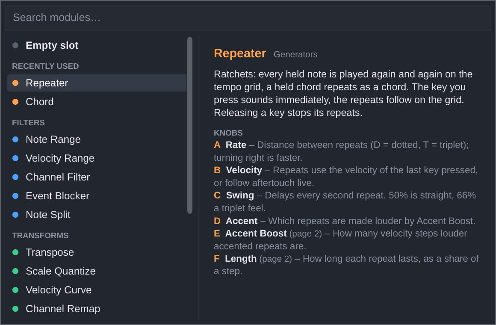
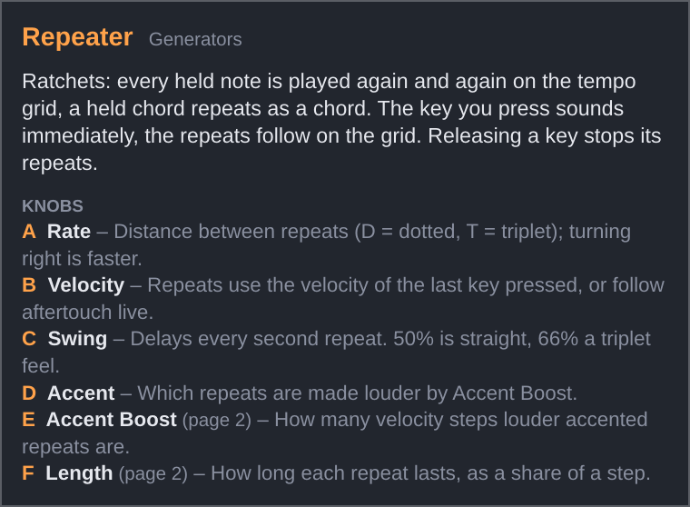

# MIDI Forge – User Manual

MIDI Forge is a MIDI effect plug-in (VST3) for Windows. It sits in front of an
instrument and changes the MIDI on its way there: it can filter notes out, transform them, generate
new ones and add controlled randomness. You build the effect from up to eight **modules** that you
stack in **slots**.

- [Installation](#installation)
- [Where to put it in your DAW](#where-to-put-it-in-your-daw)
- [The window](#the-window)
- [How the chain works](#how-the-chain-works)
- [Modules](#modules)
- [Modulation (LFOs and Random)](#modulation-lfos-and-random)
- [Presets](#presets)
- [Automation](#automation)
- [Panic and stuck notes](#panic-and-stuck-notes)
- [Troubleshooting](#troubleshooting)

---

## Installation

Download `MIDI-Forge-Windows.zip` from the project's **Releases** page on GitHub (or, for test builds,
from the **Actions** tab → latest successful run → *Artifacts*) and copy `MIDI Forge.vst3` to
`C:\Program Files\Common Files\VST3\`.

Then let your DAW rescan its plug-ins.

## Where to put it in your DAW

- **Reaper:** add MIDI Forge to a track's FX chain *above* the instrument. MIDI flows top to bottom.
- **Bitwig Studio:** put MIDI Forge in an instrument's **Note FX** section, or as a device before the instrument.

MIDI Forge does not process audio. Ableton Live cannot host MIDI-effect plug-ins.

## The window

- **Header:** the **Chain** and **Modulation** tabs, the [preset controls](#presets) and the **Panic** button.
- The **Chain** tab shows the **eight slot rows**, each with:
  - the **slot number** and a coloured strip showing the module's category,
  - a **power switch** – a switched-off slot passes everything through unchanged. When a modulation route
    moves the switch, it gets a yellow outline with a dot (filled: the slot is on right now, hollow: off),
    and the row dims whenever the modulation switches the slot off,
  - the **module menu** – click it to open the [module browser](#picking-a-module-the-module-browser) and pick
    what this slot does; picking a module resets its knobs to their defaults,
  - the **i** button – shows what the loaded module does and what each of its knobs means (both pages),
  - the **×** button – removes the module with one click. The modules below move up one slot and the empty
    slot goes to the end of the chain. For a few seconds the footer shows *Removed … from slot n* with an
    **Undo** button that puts the module back exactly as it was (knobs, power switch, page and its
    modulation routes). Undo is no longer offered once you load a module into the last slot,
  - a one-line **description** of the module (hover over it for the full text),
  - **four knobs** – drag up/down or left/right; **double-click** to reset a knob; hover over a knob to see
    what it does. Knobs with fixed steps
    (choices like *Scale*, whole numbers like *Octaves*) jump from step to step; the mouse wheel moves one
    step per notch,
  - **◀ ▶** page arrows, only for modules with more than four knobs (e.g. the Repeater): they switch between
    page 1 (knobs A–D) and page 2 (E–H). The page you look at is saved with your project and presets.
    A yellow dot on an arrow means an LFO or Random modulator moves a knob on the other page,
  - **▲ / ▼** buttons that move the module one slot up or down (its modulation routes move with it). To insert
    a module between two others, move
    an empty slot there and pick the module in it.
  - A knob that an LFO or Random modulator is moving gets a thin **yellow ring with a dot**: the knob shows your setting,
    the dot shows the value the module is using right now.
- The **Modulation** tab holds the LFOs, the Random modulators and the modulation routes, see [Modulation (LFOs and Random)](#modulation-lfos-and-random).
- **Footer:** the colour legend: blue = filters, green = transforms, orange = generators, purple = randomizers.

### Picking a module: the module browser

Click a slot's module menu (or press Return while it has the keyboard focus) to open the module browser:

- **Just start typing** to search: the list shows only the modules that match. The search looks at the
  names, the categories, the descriptions and the knob names, so *ratchet* finds the Repeater and *chord*
  finds the Chord and the modules that work with chords. Several words must all match.
- The best match is highlighted: **Return** picks it, **↑ / ↓** move through the list, **Esc** closes the browser
  without changing anything. You can of course also click a module.
- On the right you see what the highlighted module does and what each of its knobs means.
- **Empty slot** clears the slot.
- **Recently used** lists the last five modules you picked, in every project and DAW (hidden while you search).
  The list is stored in `Documents/MIDI Forge/Settings.xml`.

The **i** button next to the module menu shows the same information for the module that is loaded:

Note names follow the convention **C3 = MIDI note 60** (as in Bitwig and Cubase; Reaper calls it C4 by default).

## How the chain works

Every MIDI event enters slot 1, then goes to slot 2, and so on to slot 8 (a *Note Split* can send notes
past the remaining slots). Each module only sees what
the slots above it let through, so **order matters**: *Chord → Arpeggiator* arpeggiates chords, while
*Arpeggiator → Chord* plays a chord on every arpeggio step.

MIDI Forge takes care that no note gets stuck, even when you change modules while playing:

- Notes always end the way they started, even if you turn a knob while holding them (a transposed note
  is released at the pitch it started on).
- Switching a slot's module, turning a slot on or off, or moving modules releases the notes passing
  through that slot. Keep holding the key and nothing restarts until you press it again.
- SysEx messages pass through untouched; MIDI clock and other system messages pass through every module.

## Modules

The knobs of a slot are called **A … H** in your DAW's automation lists (most modules use A … D; page 2 is
E … H); what they mean depends on the module loaded in the slot.

### Filters (blue)

**Note Range** – passes or blocks notes inside a key range.

| Knob | Range | Meaning |
|------|-------|---------|
| Low  | C-2 … G8 | Lowest key of the range |
| High | C-2 … G8 | Highest key of the range (Low and High may be swapped) |
| Mode | Pass inside / Block inside | Keep only notes in the range, or remove them |

**Velocity Range** – passes or blocks notes by how hard they were played.

| Knob | Range | Meaning |
|------|-------|---------|
| Min  | 1 … 127 | Lowest velocity of the range |
| Max  | 1 … 127 | Highest velocity of the range |
| Mode | Pass inside / Block inside | Keep or remove notes in the range |

**Channel Filter** – keeps or removes one MIDI channel. Applies to every channel message (notes, CC, pitch bend …).

| Knob | Range | Meaning |
|------|-------|---------|
| Channel | 1 … 16 | The channel |
| Mode | Only this / All except | Keep only this channel, or remove it |

**Event Blocker** – blocks whole kinds of MIDI events.

| Knob | Range | Meaning |
|------|-------|---------|
| Notes | Pass / Block | Notes (and their poly aftertouch) |
| CC | Pass / Block | Control changes (mod wheel, sustain pedal …) |
| Pitch Bend | Pass / Block | Pitch bend |
| AT / Prog | Pass / Block | Channel aftertouch, poly aftertouch and program changes |

**Note Split** – splits the chain. Notes in the selected range continue to the slots *below* the Note
Split; all other notes **skip the rest of the chain** and go straight to your DAW, exactly as they arrived
at the Note Split. Slots *above* it still act on every note, so you usually put it in slot 1.

Example (drums): Note Split on the closed hi-hat → Repeater → Humanize ratchets and humanizes only the hi-hat,
while kick and snare play exactly as recorded (preset *Hi-Hat Ratchet (Drums)*).

| Knob | Range | Meaning |
|------|-------|---------|
| Low | C-2 … G8 | Lowest selected note |
| High | C-2 … G8 | Highest selected note. Set it to the same note as *Low* to select exactly one note (the default) |
| Octaves | This octave / Every octave | *Every octave:* the selected notes count in every octave, e.g. Low = High = C3 selects every C; A2 … C3 selects every A, A#, B and C. A range of 12 notes or more selects everything |

- Everything that is not a note (controllers, pitch bend, channel aftertouch, program changes) continues
  down the chain.
- A note's note-off and polyphonic aftertouch always take the same way as the note itself, even if you
  change the range (or an LFO moves it) while the key is held.
- You can use several Note Splits: one further down splits again what the first one let through.

### Transforms (green)

**Transpose** – shifts notes. Notes pushed outside the MIDI range are dropped.

| Knob | Range | Meaning |
|------|-------|---------|
| Semitones | −24 … +24 st | Shift in semitones |
| Octave | −4 … +4 oct | Additional shift in octaves |

**Scale Quantize** – moves every note into a key and scale.

| Knob | Range | Meaning |
|------|-------|---------|
| Root | C … B | Key of the scale |
| Scale | Major, Minor, Dorian, Phrygian, Lydian, Mixolydian, Locrian, Harm. Minor, Mel. Minor, Major Pent., Minor Pent., Blues, Whole Tone | The scale |
| Snap | Nearest / Up / Down | Where wrong notes go. *Nearest* picks the lower note when both are equally close |

If two keys land on the same scale note, it keeps sounding until both keys are released.

**Velocity Curve** – reshapes how hard notes are played.

| Knob | Range | Meaning |
|------|-------|---------|
| Curve | −100 … +100 | Negative: soft playing gets louder (more sensitive). Positive: you have to play harder. 0: linear |
| Out Min | 1 … 127 | Velocity of the softest possible note |
| Out Max | 1 … 127 | Velocity of the hardest possible note |
| Fixed | Off, 1 … 127 | If not Off, every note gets exactly this velocity (Curve, Out Min and Out Max are ignored) |

**Channel Remap** – moves events to another channel. Applies to all channel messages.

| Knob | Range | Meaning |
|------|-------|---------|
| From | All, 1 … 16 | Which channel to move (All = every channel) |
| To | 1 … 16 | Target channel |

**Note Dispatcher** – spreads notes over several MIDI channels, picking a **free** channel for every note
(or every chord). Use it to play several mono synths as one polyphonic instrument, or to alternate between
sounds on different channels. A channel is free when none of the notes sent to it are still held.

- **Round Robin** takes the next free channel above the one used last and wraps around at the end.
- **Random** picks any free channel.
- **Ping Pong** goes up and down through the channels without repeating the ends (1 2 3 4 3 2 1 2 …).
- When **every channel is busy**, the note (or chord) that started first is ended and its channel reused.
- In **Chords** mode, notes starting within the *Chord Window* count as one chord and all go to the same
  channel; the next chord goes to the next free channel.
- A note's note-off and polyphonic aftertouch always go to the channel the note went to, even if you change
  the knobs while holding it.
- Controllers (mod wheel, sustain pedal …), pitch bend, channel aftertouch and program changes are **copied
  to every channel** of the range, so all synths follow the wheels and pedals.

| Knob | Range | Meaning |
|------|-------|---------|
| Algorithm | Round Robin / Random / Ping Pong | How the next free channel is chosen |
| Mode | Single Notes / Chords | One channel per note, or one channel per chord |
| First Channel | 1 … 16 | The first channel notes are sent to |
| Channels | 2 … 16 | How many channels are used; the range stops at channel 16 (First Channel 15 with 4 channels uses 15 and 16) |
| Input *(page 2)* | All, 1 … 16 | Which incoming channel is dispatched; notes and messages on other channels pass unchanged |
| Chord Window *(page 2)* | 0 … 100 ms | Notes starting this close together count as one chord in Chords mode (default 30 ms) |

Tip: put a *Pitch Slide* after a Note Dispatcher and each synth gets its own slides, because every chord
sits on its own channel.

### Generators (orange)

**Arpeggiator** – plays the keys you hold one after another. While your DAW's transport runs, the steps
lock to the bar grid; when it is stopped, the arpeggiator runs on its own clock (at the project tempo)
and starts the moment you press the first key. The keys you hold are not passed on – only the arpeggio.

| Knob | Range | Meaning |
|------|-------|---------|
| Rate | 1/4, 1/8, 1/8T, 1/16, 1/16T, 1/32 | Step length (T = triplet) |
| Pattern | Up, Down, Up/Down, Random, As Played | Order of the notes. *Up/Down* doesn't repeat the top and bottom note; *As Played* follows the order you pressed the keys |
| Octaves | 1 … 4 | How many octaves the pattern spans |
| Gate | 5 … 100 % | Note length as a share of the step |

Up to 32 keys are tracked at once.

**Chord** – plays a chord on every note.

| Knob | Range | Meaning |
|------|-------|---------|
| Type | Major, Minor, Sus2, Sus4, Dim, Aug, Maj7, Min7, Dom7, Min9, Add9, Power, Octave, 5th + Oct | The chord, built upwards from the played note |
| Inversion | 0 … 3 | Each step moves the lowest chord note up an octave |
| Voicing | Close / Open / Bass −1 Oct | *Open* raises the second-lowest note an octave; *Bass −1 Oct* adds the played note an octave lower |
| Added Vel | 0 … 100 % | Velocity of the added notes relative to the played note |

**Note Echo** – a MIDI delay. The original note plays immediately; each echo comes one *Time* later,
quieter, and optionally transposed. Every echo is as long as the original note.

| Knob | Range | Meaning |
|------|-------|---------|
| Time | 1/32 … 1 Bar (incl. triplets T and dotted D) | Distance between echoes, synced to the tempo |
| Repeats | 1 … 16 | Maximum number of echoes |
| Feedback | 10 … 100 % | Each echo's velocity as a share of the previous one. Echoes stop when they get too quiet |
| Pitch | −12 … +12 st | Transposition added with every echo (e.g. +7 makes a rising cascade of fifths) |

**Repeater** – ratchets: while you hold keys, every held note is played again and again on the tempo grid.
A held chord repeats as a chord. The key you press sounds **immediately**; the repeats then follow on the
grid. While your DAW plays, the grid is locked to its bars; when it is stopped, the Repeater runs at the
project tempo, counting from your first key press. Releasing a key stops its repeats. Each repeat lasts
the set *Length*, but always ends before the next repeat. If you press a key less than half a step before
a grid step, that step is skipped for this key, so it never double-triggers.

The Repeater has seven knobs: use the **◀ ▶** arrows in its slot to switch between page 1 (A–D) and page 2 (E–G).

| Knob | Range | Meaning |
|------|-------|---------|
| Rate | 1/4D, 1/4, 1/8D, 1/4T, 1/8, 1/16D, 1/8T, 1/16, 1/16T, 1/32, 1/32T, 1/64 | Distance between repeats (D = dotted, T = triplet); turning right makes it faster |
| Velocity | Last Note / Aftertouch | *Last Note:* all repeats use the velocity of the key you pressed last. *Aftertouch:* how hard you press sets the velocity, live – per note if your keyboard sends polyphonic aftertouch, otherwise channel aftertouch; until you press, each note uses its own velocity. Aftertouch also still reaches your synth |
| Swing | 50 … 75 % | Delays every second repeat. 50 % is straight, 66 % is a triplet feel, 75 % a heavy shuffle |
| Accent | Off, Every 2nd, Every 3rd, Every 4th, On Beat | Which repeats are accented (made louder by *Accent Boost*). Steps are counted on the grid (from your first key press when the transport is stopped). *On Beat* accents repeats that fall on a quarter note |
| Accent Boost *(page 2)* | 0 … 64 | How many velocity steps louder accented repeats are (default 25) |
| Length *(page 2)* | 10 … 100 % | How long each repeat lasts, as a share of a step (default 50 %). At 100 % repeats join up; with swing, a repeat before a short gap is shortened so repeats never overlap |
| Chance *(page 2)* | 0 … 100 % | Probability that a repeat plays (default 100 %). Below 100 % some repeats rest, so the ratchet gets gaps. The key you press always sounds; a held chord plays or rests as a whole; accented repeats can rest too |

Tip: an LFO on *Rate* makes the ratchet speed change on its own (see the *Ratchet Chords* preset). A Random
modulator on *Chance* makes some phrases busy and others sparse.

Projects and presets from older versions open with *Chance* at 100 %, so they sound as before.

### Randomizers (purple)

**Humanize** – makes playing less mechanical. Each note is delayed by a random amount and its velocity
varied. The note-off is delayed by the same amount, so note lengths stay as played.

| Knob | Range | Meaning |
|------|-------|---------|
| Timing | 0 … 50 ms | Maximum delay (notes are only ever delayed, never moved earlier) |
| Velocity | 0 … 64 | Maximum velocity change up or down |

**Probability** – each note plays with the given chance; the rest are skipped.

| Knob | Range | Meaning |
|------|-------|---------|
| Chance | 0 … 100 % | Probability that a note plays |

**Random Pitch** – randomly transposes some notes. Put a *Scale Quantize* after it to stay in key.

| Knob | Range | Meaning |
|------|-------|---------|
| Range | 0 … 24 st | Largest possible shift |
| Chance | 0 … 100 % | Share of notes that get shifted |
| Mode | Any / Octaves / 5ths + Oct | Which intervals are used |

**Pitch Slide** – slides notes in from another pitch, or out to another pitch, using **pitch bend**. The notes
themselves play unchanged and on time.

- *Slide In:* the note starts at *Offset* and glides to its own pitch (a "scoop").
- *Slide Out:* the note starts at its own pitch and glides to *Offset* (a "fall" or "rise").
- Pitch bend moves the whole MIDI channel, so **a chord slides together**: notes starting within 30 ms
  count as one chord and get one slide (and one *Chance* decision). A note you add later starts a new slide,
  and the notes you are holding bend along. When the last note ends, the pitch returns to normal.
- **Set *Bend Range* to your synth's pitch bend range** (often 2 semitones; many synths let you raise it to
  12 or 24). Only then does a slide of, say, 7 semitones land exactly on the fifth. Slides larger than the
  bend range stop at its end.
- Your own pitch bend wheel still works: it is added to the slide.

The Pitch Slide has seven knobs on two pages (A–D, E–G):

| Knob | Range | Meaning |
|------|-------|---------|
| Offset | −24 … +24 st | Where the slide starts (Slide In) or ends (Slide Out), relative to the note (default −2) |
| Mode | Slide In / Slide Out | See above |
| Length | 1/64 … 1 Bar (incl. triplets T and dotted D) | How long the slide takes, synced to the tempo (default 1/16) |
| Chance | 0 … 100 % | Probability that a note (or chord) slides (default 100 %) |
| Curve *(page 2)* | −100 … +100 | 0: even slide. Negative: fast start, slow end. Positive: slow start, fast end |
| Bend Range *(page 2)* | 1 … 48 st | Your synth's pitch bend range (default 2) |
| Delay *(page 2)* | Off, 1/64 … 1 Bar | When the slide starts after the note begins. With Slide In the note waits at Offset until then |

Tip: Slide Out with a Delay of 1/8 and a negative Offset makes notes fall off after being held for a moment.

## Modulation (LFOs and Random)

Two kinds of **modulation sources** move slot knobs automatically, without DAW automation:

- four **LFOs** (low-frequency oscillators) that move continuously: an LFO on *Note Echo · Pitch* makes the
  echoes rise and fall, an LFO on *Arpeggiator · Gate* lets the notes breathe;
- four **Random** modulators that pick a new random value every time you play a note: every chord gets its
  own inversion, every note a slightly different loudness.

They make no sound themselves; they only move the settings of the MIDI modules. All of this lives on the
**Modulation** tab, and the eight **routes** at the bottom connect sources to knobs.

### LFOs

| Control | Range | Meaning |
|---------|-------|---------|
| Wave | Sine, Triangle, Saw Up, Saw Down, Square, S&H, Smooth Random | The shape. *S&H* (sample and hold) jumps to a new random value every cycle; *Smooth Random* glides from one random value to the next |
| Sync | Tempo / Free | *Tempo:* the cycle length is a note value. *Free:* the speed is set in Hz |
| Rate (Tempo) | 8 Bars … 1/32 (incl. dotted D and triplets T) | Length of one cycle; turning right makes it faster |
| Rate (Free) | 0.01 … 20 Hz | Cycles per second |
| Phase | 0 … 360° | Shifts the wave, e.g. to run two LFOs against each other |
| Width | 5 … 95 % | Square wave only: how much of the cycle the wave is high |
| Restart on key | on / off | Restarts the cycle when you press a key while no other key is held, so every phrase starts the same way |

The preview shows the wave's shape and a white dot where the LFO is now; the number in the top right is
its current output (−100 … +100). For the random waves the preview shows an example of their character.

**Timing:** a tempo-synced LFO follows the DAW's bar grid while the transport runs, so it is always at the
same place at the same bar, even when you jump around in the song. When the transport is stopped it keeps
running at the project tempo. A free LFO always runs on its own clock.

### Random modulators

Each **Random** modulator picks a new random value when you play a note and keeps it until the next note.
The new value applies immediately, to the very note that triggered it.

| Control | Range | Meaning |
|---------|-------|---------|
| Chord window | 0 … 100 ms (default 30) | Notes you play within this time after the first one count as one chord and share its value. Chords are rarely played perfectly together; this keeps all their notes on the same random setting. The window is counted from the note that picked the value |
| New value on | Every note / Phrase | *Every note:* each played note (or chord) gets a new value. *Phrase:* only a note you play while no other key is held gets a new value, so legato lines keep one value |
| Steps | Smooth, 2 … 12 | *Smooth:* any value. *2 … 12:* only that many evenly spaced values – useful for knobs with choices, e.g. 4 steps on *Chord · Inversion* gives each of the four inversions the same chance |

The bar and number at the top show the current value (−100 … +100). Only notes you **play** into MIDI
Forge pick new values; notes the plug-in generates itself (arpeggio steps, repeats, echoes) keep the value
of the note that started them.

### Modulation routes

The eight routes connect a source to a slot knob:

| Control | Meaning |
|---------|---------|
| Source | LFO 1 … 4 or Random 1 … 4 |
| Target | Which knob, named after the module in that slot, e.g. *Slot 2 · Gate*, or a slot's power switch (*Slot 2 · On/Off*). The menu lists the knobs of every loaded module, slot by slot (both pages), followed by its On/Off switch. *None* switches the route off |
| **±** / **+** | Polarity. **±** (bipolar, the default): the source moves the knob below *and* above its position. **+** (unipolar): the source only pushes the knob **up** from its position (or only **down** with a negative amount). Click to switch |
| Amount | −100 … +100 %. How far the source moves the knob. At 100 % it can sweep the knob's whole range; negative amounts turn the source upside down. Double-click: 50 % |

- With **±**, set the knob to the centre of the movement you want. With **+**, set it to where the movement
  should start – this is the right choice for knobs at the bottom of their range (Inversion 0, Octaves 1 …),
  where the downward half of a bipolar swing would be cut off.
- On **+** routes, Sine and Triangle LFOs start their cycle at the lowest point, so with *Restart on key*
  every phrase starts exactly at the knob position and then rises. The same LFO can drive **±** and **+**
  routes at the same time.
- Values are limited to the parameter's range. Several routes on the same knob add up. One source can drive
  several routes.
- On knobs with fixed choices (scale, chord type, arpeggiator pattern …) the source steps through the choices.
- **On/Off targets** switch a whole slot. The switch counts as 0 (off) or 1 (on) and the modulation is added:
  a switched-on slot turns off when the result drops below 0.45, a switched-off slot turns on when it rises
  above 0.55 (the gap keeps a slow source from flickering the slot on and off). Examples: a switched-on slot
  with a bipolar route at −100 % is off whenever the source is high; a switched-off slot with a unipolar
  route at +100 % joins in while the source is above 55 %. A *Random* modulator on a switch decides per note
  or phrase whether the module plays (e.g. only some phrases get the Note Echo). As with clicking the
  switch, notes passing through the slot are released when it switches; a held key sounds again when you
  press it again.
- Routes follow their module: when a module moves (▲ / ▼, or because a module above it was removed), its
  routes keep pointing at it. Routes to a removed module are set to *None* (Undo restores them).
- The module type and the slot's on/off switch cannot be modulated (switching them releases notes).
- If you change the module in a slot, routes to that slot keep pointing at the same knob position (A … H),
  which now belongs to the new module. The target name shows what it controls.
- Modulation never changes your knob settings, and it never writes into your DAW's automation.
- Values are taken at the exact moment a note arrives; notes the plug-in generates itself
  (arpeggio steps, echoes) use an LFO value at most 32 samples old.

## Presets

A preset stores the complete setup: all eight slots, the four LFOs and the eight routes.

### The preset controls

| Control | What it does |
|---------|--------------|
| **◀ / ▶** | Previous / next preset: the factory presets first, then yours, wrapping around |
| **Preset menu** | Pick any preset. The menu has two sections, *Factory* and *User* (your presets, alphabetical) |
| **\*** after the name | Your settings differ from the saved preset |
| **Save** | If one of *your* presets is loaded: saves the changes into it. Otherwise asks for a name, like *Save As* |
| **⋯ → Save As…** | Saves the current settings under a new name (asks before replacing an existing preset) |
| **⋯ → Rename…** | Renames the loaded user preset |
| **⋯ → Delete** | Moves the loaded user preset to the trash (asks first). Your current settings stay as they are |
| **⋯ → Import…** | Copies a `.mfpreset` file (e.g. one someone sent you) into your presets and loads it. Never overwrites: a second copy gets " (2)" |
| **⋯ → Show preset folder** | Opens the folder in Explorer / Finder |

Factory presets cannot be changed or deleted; save your changes as your own preset instead.

### Where your presets are stored

Every preset is a small file called `Name.mfpreset` in `Documents\MIDI Forge\Presets\`.

Because they are in one place, your presets are available in every project and every DAW. Back up or
share them by copying the files. You can also copy files into the folder directly; while the plug-in window
is open, MIDI Forge notices new or removed files within a couple of seconds. Names may not contain `/ \ : * ? " < > |` – such characters are
replaced by spaces.

Preset files are checked when they are loaded: files that are damaged, not from MIDI Forge, or larger
than 256 KB are refused, and values outside a parameter's range are limited to the range.

### Factory presets

| Preset | Chain |
|--------|-------|
| Init | All slots empty |
| Chord Arp | Chord (Min7) → Arpeggiator (1/16, Up/Down, 2 octaves) → Humanize |
| Scale Lock (C Minor) | Scale Quantize (C minor) → Velocity Curve (more sensitive, 20–120) |
| Echo Cascade | Note Echo (1/8 dotted, 6 repeats, +7 st) → Scale Quantize (C minor pentatonic) |
| Generative Dorian | Probability 60 % → Random Pitch (octaves) → Scale Quantize (D Dorian) → Note Echo (1/4 triplet) → Humanize |
| Bass Split to Ch 2 | Note Range (up to B2) → Channel Remap (to channel 2) → Velocity Curve (fixed 100) |
| Breathing Arp | Chord (Maj7) → Arpeggiator (1/16, Up/Down, 2 octaves); LFO 1 (triangle, 2 bars) moves the gate, LFO 2 (S&H, 1 bar) picks a new chord inversion every bar |
| Wandering Echo | Note Echo (1/8 dotted, 5 repeats) → Scale Quantize (C minor pentatonic); LFO 1 (smooth random, 1 bar) lets the echo pitch step drift |
| Ratchet Chords | Chord (Min7, open voicing) → Repeater (1/16, swing 58 %, accents on the beat); LFO 1 (S&H, 1/2 bar) switches the ratchet speed between 1/8T, 1/16 and 1/16T |
| Hi-Hat Ratchet (Drums) | Note Split (F#1, the General MIDI closed hi-hat) → Repeater (1/16, swing 56 %, accents on the beat) → Humanize; kick, snare and everything else pass untouched |
| Random Voicings | Chord (Maj7) → Velocity Curve (40–100) → Humanize; Random 1 (4 steps, **+**) gives every chord one of the four inversions, Random 2 (smooth, **±**) gives it its own loudness |

Your current settings are also saved with your DAW project, together with the name of the loaded preset.
Your DAW's own program list shows only the factory presets; your DAW's preset functions keep working too.

## Automation

Each slot has ten automatable parameters: **Slot n Module**, **Slot n On** and **Slot n A … H**.
The LFOs (**LFO n Wave, Sync, Rate, Division, Phase, Pulse Width, Restart On Key**), the Random modulators
(**Random n Chord Window, New Value On, Steps**) and the routes (**Route n Source, Target, Amount, Polarity**)
can be automated too.
Your DAW displays A … H in the units of the module currently loaded in that slot, and you can type
values in those units (e.g. `+7 st`, `1/16`, `C3`, `75%`). Automation is not stepped: the modules round
to the nearest step themselves.

Automating **Slot n Module** works, but keep in mind that A … H keep their values when the module changes
(choosing a module in the plug-in window resets them; automation does not).

## Panic and stuck notes

If a note ever hangs (for example because the instrument missed a message), press **Panic**. It releases
every note MIDI Forge has sent, sends *All Notes Off* on all 16 channels and resets the pitch bend
(useful if a [Pitch Slide](#randomizers-purple) left a synth out of tune).

## Troubleshooting

| Problem | Solution |
|---------|----------|
| A preset file is refused | It is damaged, not a MIDI Forge preset, or larger than 256 KB |
| DAW doesn't list MIDI Forge | Check the install folder, then rescan plug-ins |
| No sound | MIDI Forge outputs MIDI only – it must sit *before* an instrument on the same track |
| Arpeggiator or echo at the wrong speed | They follow the project tempo; check the tempo of the project |
| Arpeggiator doesn't follow the bar grid | It only locks to the grid while the transport is running |
